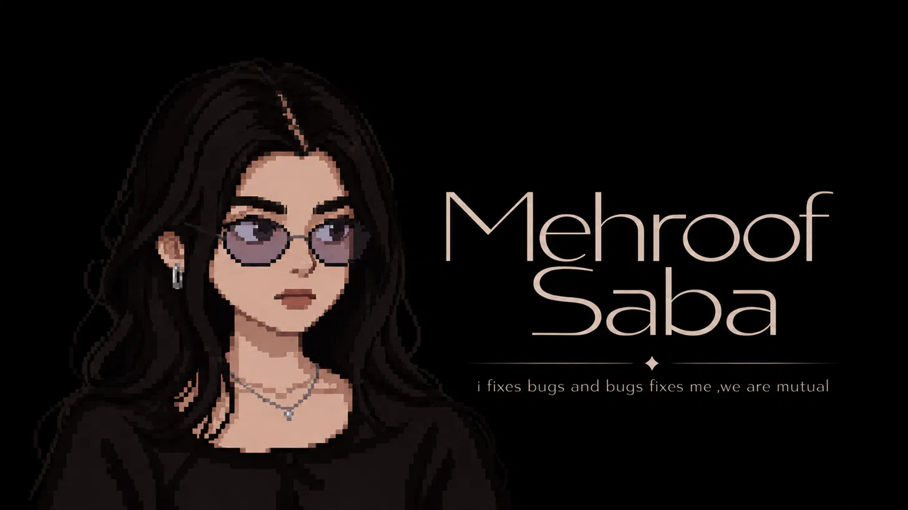

<!-- PROJECTS_ACTIVITY:START -->
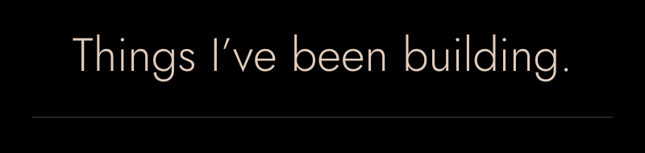

<a href="https://github.com/mehroofsaba/Digital-Herbarium">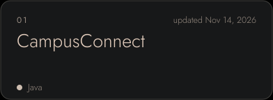</a>
<a href="https://github.com/mehroofsaba/Bizcuits">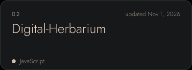</a>
<a href="https://github.com/mehroofsaba/AfterHours">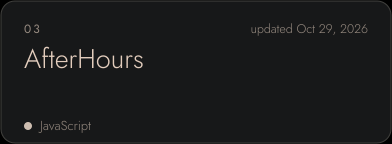</a>
<a href="https://github.com/mehroofsaba/Detour">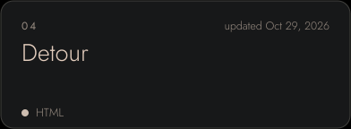</a>
<a href="https://github.com/mehroofsaba/Slothy">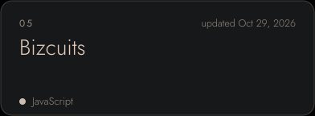</a>
<a href="https://github.com/mehroofsaba/skills-code-with-codespaces">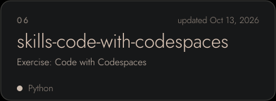</a>
<a href="https://github.com/mehroofsaba/skills-introduction-to-repository-management">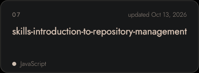</a>
<a href="https://github.com/mehroofsaba/The-Midnight-Door">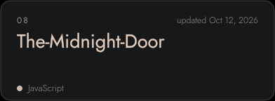</a>
<a href="https://github.com/mehroofsaba/skills-getting-started-with-github-copilot">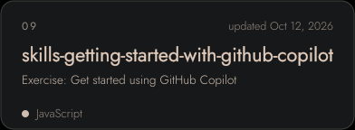</a>
<a href="https://github.com/mehroofsaba/TaskPetal">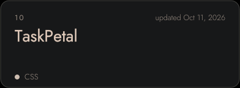</a>
<a href="https://github.com/mehroofsaba/Floof">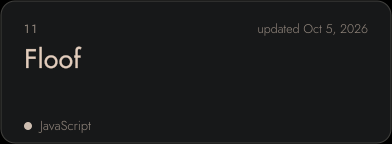</a>
<a href="https://github.com/mehroofsaba/Hacktoberfest">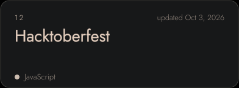</a>
<a href="https://github.com/mehroofsaba/Wobble">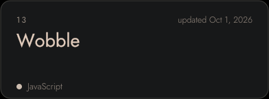</a>
<a href="https://github.com/mehroofsaba/Portfolio">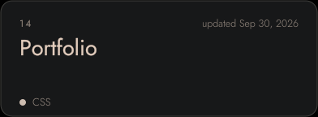</a>
<a href="https://github.com/mehroofsaba/CyberDefuse">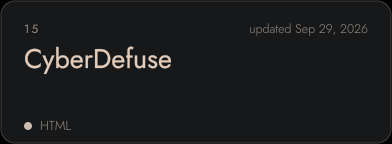</a>
<a href="https://github.com/mehroofsaba/HissyHiss">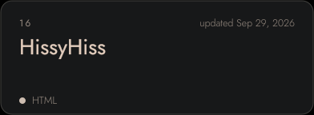</a>
<a href="https://github.com/mehroofsaba/Oneiric">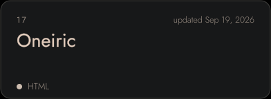</a>
<a href="https://github.com/mehroofsaba/CampusConnect">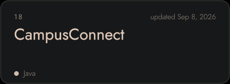</a>
<a href="https://github.com/mehroofsaba/ChessMaster">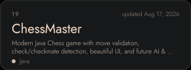</a>
<a href="https://github.com/mehroofsaba/Calculator">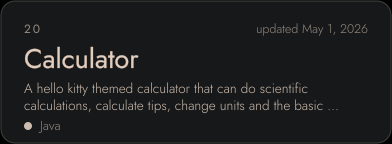</a>

<a href="https://github.com/mehroofsaba/Digital-Herbarium/commit/79a6aef641a647ae1aef6e108e6f6f245d1231d5">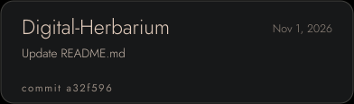</a>
<a href="https://github.com/mehroofsaba/Digital-Herbarium/commit/15bbe021addf4b96d1722feaafc69c7b969c3b7d">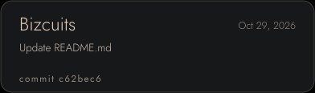</a>

<a href="https://github.com/mehroofsaba/Bizcuits/commit/c62bec6ebbf55e4547f255d8cd1e303baac2800a">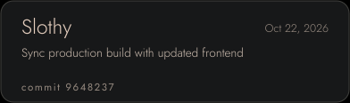</a>
<a href="https://github.com/mehroofsaba/Bizcuits/commit/7188eff1793bc979f9a6a7fdfce46de216a0503e">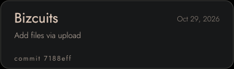</a>
<a href="https://github.com/mehroofsaba/Bizcuits/commit/930be102f867a4aa902b4fdbb14a32950fc79a42">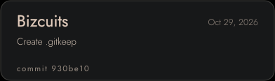</a>

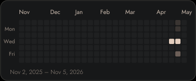
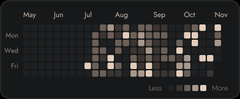

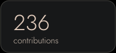
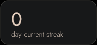
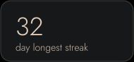
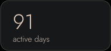

<!-- PROJECTS_ACTIVITY:END -->

<!-- TECH_CONNECT:START -->
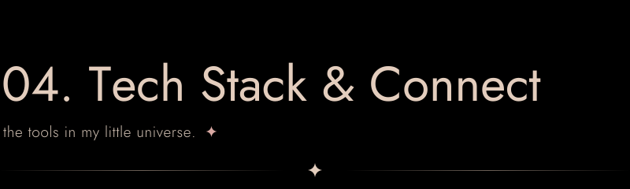

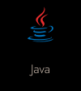
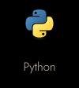

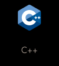

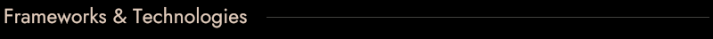

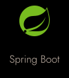
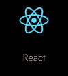
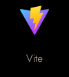

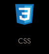

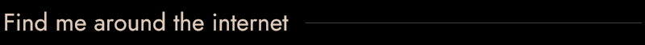

<a href="https://leetcode.com/u/MEHroof/">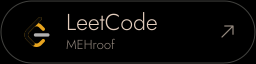</a>

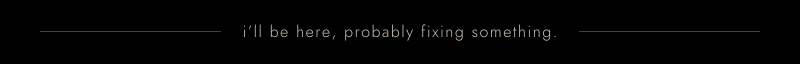
<!-- TECH_CONNECT:END -->
