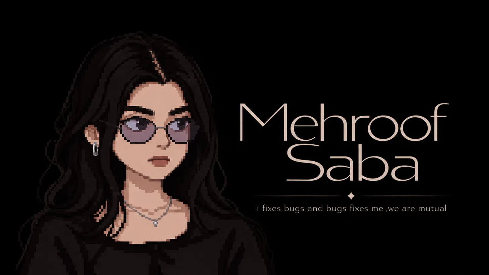

<!-- PROJECTS_ACTIVITY:START -->
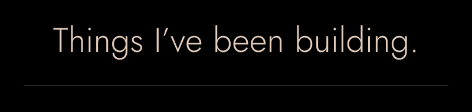

<a href="https://github.com/mehroofsaba/Portfolio">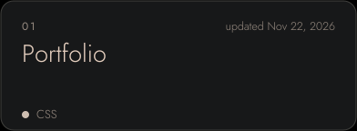</a>
<a href="https://github.com/mehroofsaba/Aquaria">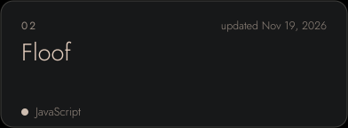</a>

<a href="https://github.com/mehroofsaba/mori/commit/546be2efdda0ccebe71726ac5a94df3e8cb13e9b">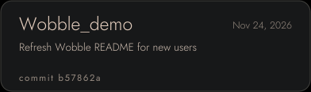</a>

<a href="https://github.com/mehroofsaba/the-great-crossing/commit/32f8b1ea0eec517561fee1f0ebc8c9b66bc7e94f">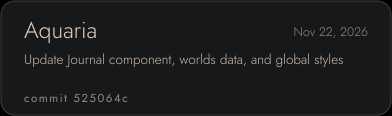</a>
<a href="https://github.com/mehroofsaba/Digital-Herbarium/commit/f6bb40dd517d105dbf2c5db0a05af0b8a9bddee3">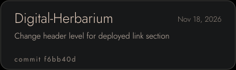</a>

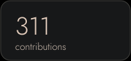
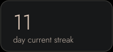
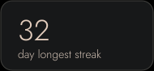

<!-- PROJECTS_ACTIVITY:END -->

<!-- TECH_CONNECT:START -->
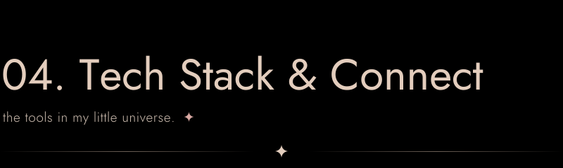

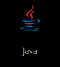

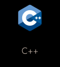

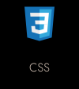

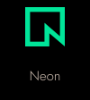

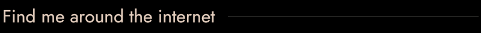

<a href="https://leetcode.com/u/MEHroof/">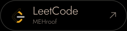</a>

<!-- TECH_CONNECT:END -->
