<!-- PROJECTS_ACTIVITY:START -->

<a href="https://github.com/mehroofsaba/Portfolio">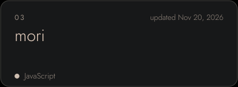</a>

<a href="https://github.com/mehroofsaba/mori">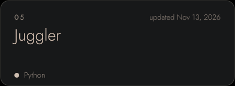</a>
<a href="https://github.com/mehroofsaba/Floof">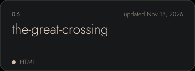</a>

<a href="https://github.com/mehroofsaba/lumen/commit/64c33718d409ac787c8fce241b5b0a1062750ddf">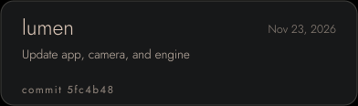</a>

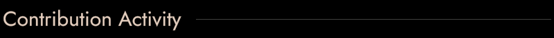

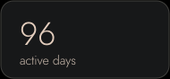

<!-- PROJECTS_ACTIVITY:END -->

<!-- TECH_CONNECT:START -->

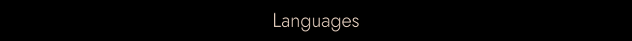

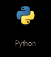

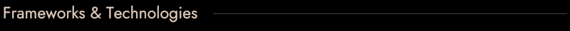

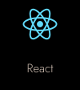
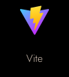
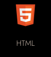

<a href="https://www.instagram.com/ms_37ann/">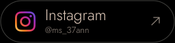</a>

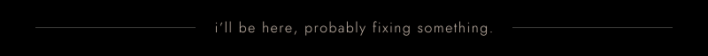
<!-- TECH_CONNECT:END -->
